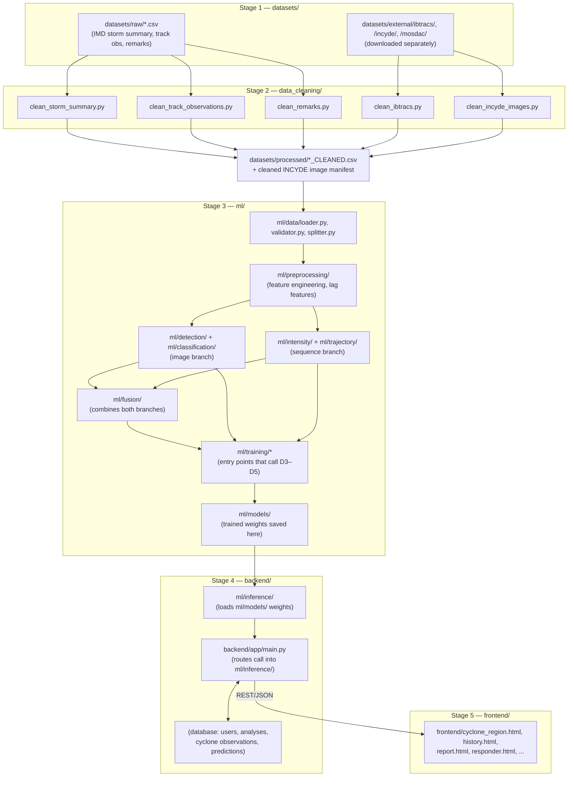
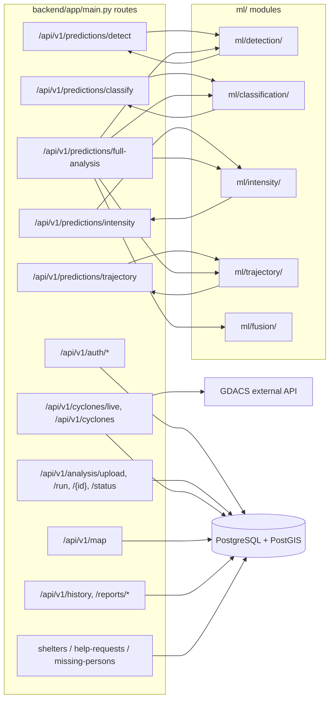
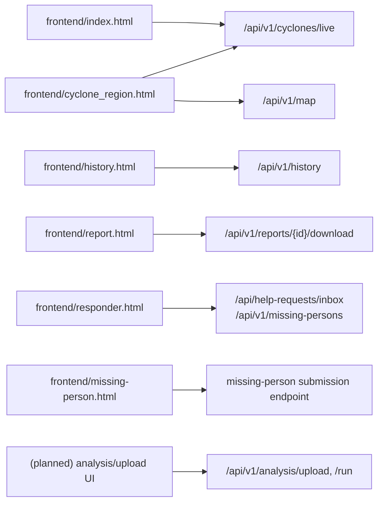

# Project Flow — Directory-to-Directory / File-to-File

This traces exactly which folder or script hands off to which other folder or
script, end to end: raw data → cleaning → EDA/features → model training →
trained weights → backend inference → API → frontend.

## 1. High-level pipeline

## 2. Backend route → module map

Which file in `backend/app/main.py` is expected to call which `ml/` module
(per the two work plans in `docs/`):

## 3. Frontend page → backend route map

## 4. Reading the diagrams

- **Solid data path (Stages 1→2→3):** nothing in `ml/` should ever read
  directly from `datasets/raw/` or `datasets/external/` — it always goes
  through the matching script in `data_cleaning/` first, landing in
  `datasets/processed/`.
- **Stage 3 fan-out:** `ml/preprocessing/` output feeds *two independent
  branches* — the image branch (`detection/`, `classification/`) and the
  sequence branch (`intensity/`, `trajectory/`) — which only meet again at
  `ml/fusion/`. Train and validate each branch on its own before wiring the
  fusion model.
- **Stage 3→4 handoff:** only `ml/models/` (trained weights) and
  `ml/inference/` (the loading/prediction interface) are consumed by the
  backend. `backend/app/main.py` should never import training code directly.
- **Cross-storm leakage:** when splitting train/test anywhere in Stage 3, split
  by `storm_id`, never by row — this is called out explicitly in the pipeline
  doc (`docs/SIH_Cyclone_Project_Pipeline.pdf`, Stage 6) and must hold for
  every one of `detection/classification/intensity/trajectory/fusion`.
